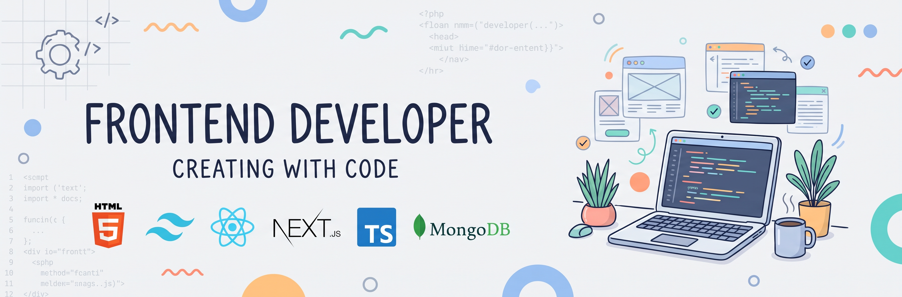

<!-- Banner Image -->

  

<!--- title --->

  <ul align="center">
    
<h1 style="display: inline-block">Hello and welcome, I'm Noushin Fatema</h1>

    <!--- typo --->
    
  </ul>

<!-- 

 #  Hello and welcome. I am Noushin Fatema! 👋

 -->

## 👩‍💻 About Me
I am a Computer Science and Engineering (CSE) graduate currently working as a Frontend Developer. Alongside web development, my primary research interest is in audio deepfake detection, and I am actively exploring the field of cybersecurity. I love learning new technologies and bringing ideas to life through code.

- 🔭 **Currently working on:** Building engaging and interactive frontend projects.
- 🌱 **Currently learning:** Python and Machine Learning frameworks.
- 🔬 **Research & Activities:** I am building a habit of reading one research paper a day, currently focusing on papers related to audio deepfake detection.

---
<!--- technology --->
##  <b> TECHNOLOGY STACK:</b>

### Frontend Technologies

### Databases & Authentication

### Tools

---

## 🌐 Follow me on socials 
Let's connect:

---

## 📊 GitHub Stats

  
  

  

---

